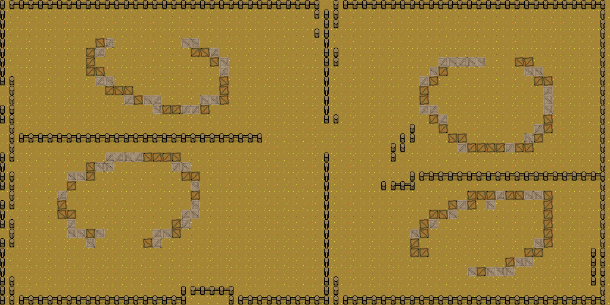
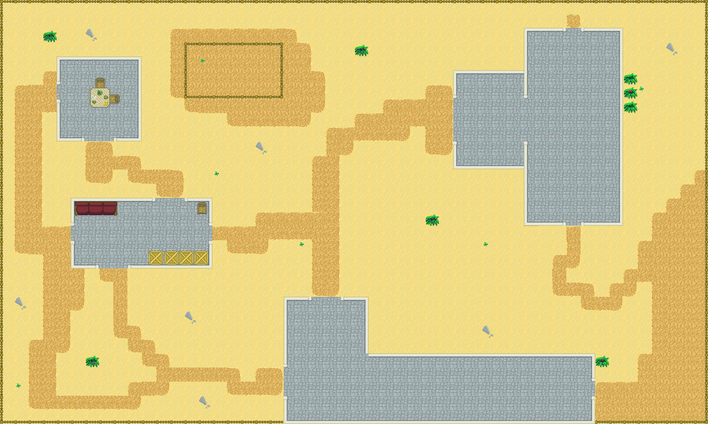

# Tequila Kill : versions Unity historiques

La [fiche unique de présentation du concept](../output/pdf/tequila-kill-fiche.pdf) réunit désormais une sélection des graphismes originaux et des versions Unity v1 et v3. Les fiches par version ci-dessous restent des références d’archives.

Les archives locales contiennent trois distributions Windows compilées : **TequilaKill_v1**, **TequilaKill_v3** et **MexicanTekilaWar_0-0-3**, cette dernière sous `TheMexicanTequilaWar/dist/`. Ce sont des jeux exportés ; aucun projet source Unity complet n'est établi dans ces dossiers. Les fiches historiques ci-dessous portent sur v1 et v3. La galerie locale `output/anciens-graphismes/index.html` ajoute les images extractibles du troisième build et les autres ressources des archives.

L'inventaire du 22 novembre 2026 relève un fichier manquant dans le build 0-0-3 : `sharedassets1.assets.resS`. Il empêche l'extraction de 54 entrées de sprites ou textures de cette distribution. Les noms concernés et toutes les provenances figurent dans l’inventaire local `output/anciens-graphismes/inventaire.json`.

Les graphismes ci-dessous proviennent des fichiers de ces distributions. Les vues d’arène sont des **reconstitutions statiques des scènes**, et non des captures prises pendant une partie : les sprites sont replacés selon leurs transformations et leurs ordres de tri enregistrés. Les personnages créés pendant le jeu, les effets dynamiques et les shaders ne sont pas simulés.

## Unity v1

[Fiche de présentation illustrée, une page](../output/pdf/tequila-kill-unity-v1-fiche.pdf).

- Arène en quatre quartiers, avec barrières et caisses.
- Portraits dessinés de Don Ramiro et Poncho Miguel.
- Affiches « Wanted » et panneaux de bois.
- Petits sprites de sombrero, arme, caisse, barrière, vie et explosion.

La fiche rassemble onze graphismes. Leur provenance est conservée dans le [relevé des sources v1](assets/unity-v1/sources.json).

## Unity v3

[Fiche de présentation illustrée, une page](../output/pdf/tequila-kill-unity-v3-fiche.pdf).

- Village de sable clair avec plusieurs bâtiments de pierre.
- Portraits en pixel art d’El Poncho et Garcia.
- Panneau de sélection et fond de menu.
- Sombrero, arme, caisses, table, chaise et canapé.

La fiche rassemble onze graphismes. Leur provenance est conservée dans le [relevé des sources v3](assets/unity-v3/sources.json).

## Bruitage de rechargement

Les trois builds contiennent le même clip `Gun_Reload`. La v0.1 joue un extrait de 63 ms, à partir de 472 ms, avec de courts fondus aux extrémités. L’extrait vient de l’AudioClip 13 dans `TequilaKill_v3.0_Data/resources.assets`, décodé avec UnityPy 1.25.4. [Fichier WAV intégré à Godot](../godot/scenes/character/assets/audio/reload_cartridge.wav)

## Rapport avec le nouveau concept

Ces fiches documentent l’héritage visuel. Elles ne prouvent pas que les règles ou le nombre de joueurs du [concept actuel](concept.md) étaient implémentés dans les versions historiques. Le nom **Arroyo Seco** et la situation en Arizona appartiennent au concept retenu pour la nouvelle version.

Extraction réalisée le 7 novembre 2026 avec [UnityPy](https://github.com/K0lb3/UnityPy), version 1.25.4. Les distributions originales ont été lues sans modification et n’ont pas été exécutées.
